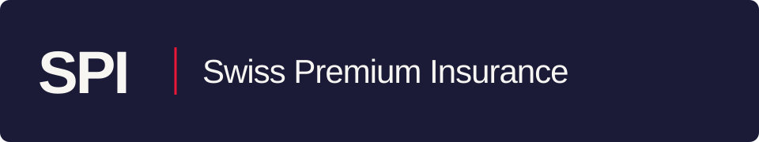
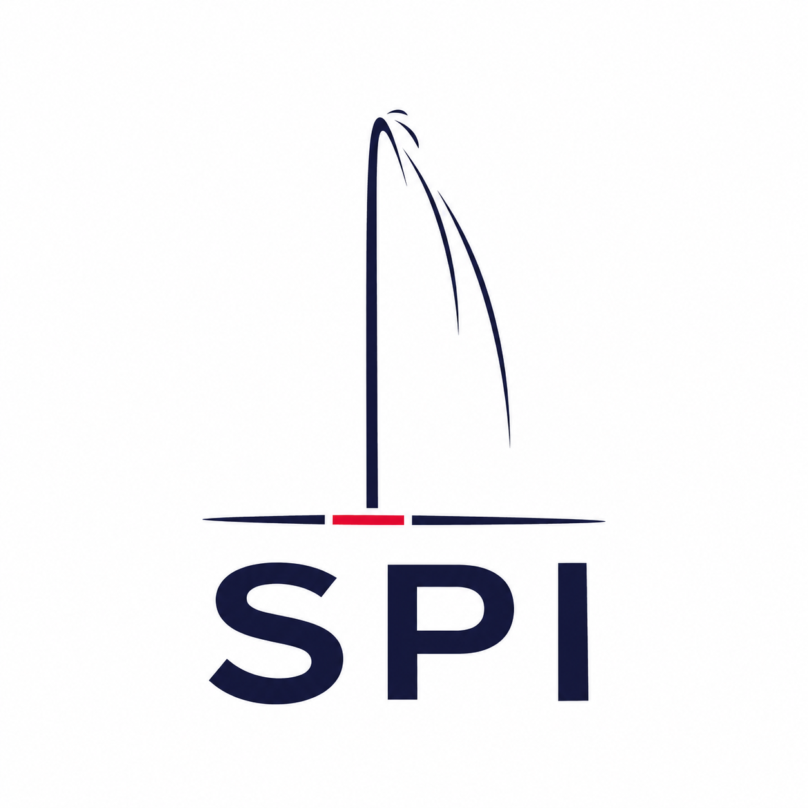

  

  <strong>Votre partenaire en assurances à Genève.</strong> 
  Assurances, prévoyance et accompagnement pour les particuliers, les professionnels et les frontaliers.

  <a href="https://www.swiss-premium-insurance.ch/"><strong>Notre site ↗</strong></a>
  &nbsp;&nbsp; · &nbsp;&nbsp;
  <a href="https://github.com/SwissPremiumInsurance/mcp">Notre intégration MCP</a>
  &nbsp;&nbsp; · &nbsp;&nbsp;
  <a href="mailto:contact@sp-insurance.ch">Nous contacter</a>

 

### Swiss Premium Insurance

Nous sommes un courtier en assurances basé à Genève. Notre équipe vous aide à comprendre vos couvertures, à comparer les solutions et à préparer vos projets.

Assurance maladie, ménage, véhicule, prévoyance ou besoins professionnels : retrouvez nos services et notre équipe sur **[swiss-premium-insurance.ch](https://www.swiss-premium-insurance.ch/)**.

### Nos projets numériques

| Projet | Pour les développeurs |
| :--- | :--- |
| **[SPI MCP ↗](https://github.com/SwissPremiumInsurance/mcp)** | Connecter les assistants IA au service de comparaison LAMal de Swiss Premium Insurance. |
| **Connexion & intégrations** | Guide de connexion, fichiers de configuration et exemples pour utiliser notre service MCP. |

### Notre approche

**La clarté avant tout.** Comprendre les garanties et les critères de comparaison pour décider en connaissance de cause.

**Des outils utiles.** Des services numériques au service du conseil et de la compréhension des assurances.

**Un accompagnement humain.** L’équipe SPI reste votre interlocuteur pour vos questions et vos démarches.

---

  

  <strong>Swiss Premium Insurance</strong> 
  Genève, Suisse · <a href="mailto:contact@sp-insurance.ch">contact@sp-insurance.ch</a> 
  Insurance advice and digital services, from Geneva.

